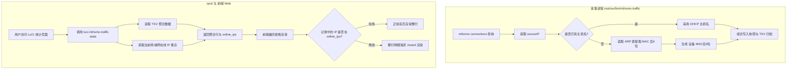

# 设备主机名持久化与在线状态呈现需求规格

## Summary

将流量采集从单 IP 记录改造为同时固化主机名与 IP，彻底解决 DHCP 租约到期后历史统计退化为纯数字 IP 的问题。前端展示直接使用固化名称并按 IP 独立保持设备隔离，同时根据当前网络状态对已离线设备整行浅灰显示。

---

## Problem Frame

当前组件在每秒轮询采集 mihomo 连接数据时，仅将来源 IP（`m.sourceIP`）写入存储文件。设备主机名依赖用户打开网页时动态读取 `/tmp/dhcp.leases`（dnsmasq 内存临时租约）和 UCI 静态分配列表反向推导。

当设备 DHCP 租约过期、设备断开重连，或现代移动系统（iOS / Android）周期性轮换随机 MAC 导致 IP 变动时，`/tmp/dhcp.leases` 中的旧 IP 记录被销毁。系统回溯历史流量时无法找到对应的主机名，导致原本有名字的设备退化成冰冷的裸 IP。此外，若简单按设备名强行合并，又会导致局域网内重名设备（例如多台默认名为 `iPhone` 的设备）流量混淆；而在历史记录中，用户也无法直观分辨哪些设备目前仍在网活跃、哪些只是历史过客。

---

## Key Decisions

- **采集时双字段持久化固化**：采集进程在落盘快照（`/tmp/mihomo-traffic.cur`）与整点归档 TSV（`/etc/mihomo-traffic/YYYY-MM-DD.tsv`）时，同时将当时的来源 IP 与解析到的主机名固化写入数据文件，不再将设备身份推迟到展示时反查。
- **按 IP 独立成行展示**：每条设备明细保持物理 IP 粒度隔离，展示格式为 `主机名 (IP)`。确保局域网内即便存在多台重名设备（如两台均名为 `iPhone`），各自的流量与连接也清晰独立，不发生误合并。
- **无名设备提取 MAC 后四位兜底**：对于未在 DHCP 请求中上报主机名（显示为 `*` 或空）的 IoT 设备、插座与摄像头，通过系统 ARP 表提取其 MAC 地址后 4 位，生成形如 `设备-[A1B2]` 的稳定展示标识。
- **展示端直接消费存储名称**：rpcd 查询与前端渲染直接使用存储记录中的设备标识，彻底移除前端使用全局名称字典进行二次反查与拼接的逻辑。
- **实时在线状态感知与整行浅灰渲染**：rpcd 响应历史查询时附带返回当前在线的活跃 IP 集合。前端渲染明细表格时，当前仍在线的设备正常高亮显示；当前已离线的历史设备整行明细（包含指标数字）整体浅灰（muted）呈现。
- **改名自修改时点生效**：用户在 OpenWrt 中为设备新增或修改静态主机名仅对后续采集生效，不对已归档的历史 TSV 文件进行重写，避免对路由器存储产生 I/O 负担。
- **历史旧数据向后兼容**：读取升级前仅有 6 列的旧版本 TSV 数据时，自动回退兼容旧逻辑，确保升级后 30 天历史数据无缝可用。

---

## Key Flows

- F1. 设备流量采集与名称固化
  - **Trigger:** 采集守护进程每秒轮询 mihomo 接口。
  - **Steps:** 提取连接 `metadata.sourceIP`；优先匹配 UCI 静态绑定及当前 DHCP 租约中的主机名；若主机名缺失，读取 `/proc/net/arp` 提取对应 MAC 后 4 位组合命名；连同 IP、节点、目标、流量增量一并写入内存聚合表与归档 TSV。
  - **Outcome:** 数据文件中各行自带当时的准确设备标识。
  - **Covered by:** R1, R2, R3, R4

- F2. 历史流量查询与在线状态感知渲染
  - **Trigger:** 用户打开或刷新 LuCI Mihomo 流量页面。
  - **Steps:** 后端 rpcd 读取指定时段的 TSV 聚合数据，同时采集当前处于活跃状态的局域网 IP 列表，将两者一并返回前端；前端渲染表格时直接取用数据中的设备标识，并对比在线 IP 列表判定样式。
  - **Outcome:** 历史设备名永久保留，当前在线设备鲜明突出，已离线设备低调整行置灰。
  - **Covered by:** R5, R6, R7, R8

---

## Requirements

### 数据采集与存储固化

- R1. 采集进程必须在轮询写入快照与归档文件时，将来源设备的 IP 与设备名称同时持久化存储。
- R2. 存储行格式升级为兼容结构，使每条明细均显式绑定产生该流量时的设备标识。
- R3. 采集进程内部维护轻量 IP 名称映射缓存，避免每次轮询重复频繁读取底层文件。

### 无名与重名设备处理

- R4. 当设备未上报主机名时，采集进程必须回退尝试读取系统 ARP 缓存提取 MAC 地址，取后 4 位格式化为 `设备-[XXXX]` 作为名称。
- R5. 数据以 `IP` 作为独立行的区分基准，即便局域网存在多台同名设备，各自保持独立行展示，严禁强制按名称跨 IP 合并。

### 在线状态感知与接口支持

- R6. `luci.mihomo-traffic` rpcd 接口在执行 `stats` 查询时，必须返回当前局域网处于活跃租约或在线状态的 IP 集合。
- R7. 设备是否在线的判定基准为当前系统有效的 DHCP 动态租约与活跃 ARP 记录。

### 前端呈现与视觉反馈

- R8. 前端明细表格与图表必须直接使用存储返回的设备标识与 IP 组合展示，禁止在前端再次做全量名称字典反查。
- R9. 前端渲染明细表格时，对于当前不在活跃在线列表中的历史设备，必须将整行明细（包含设备名、IP、上传量、下载量与合计）采用 `mt-muted`（半透明浅灰）样式显示。
- R10. 当前处于在线状态的设备行保持原有默认高亮样式。

### 兼容性与演进

- R11. 数据加载逻辑必须平滑兼容升级前生成的 6 列格式历史 TSV 文件。对于老格式数据行，采用兼容模式自动补齐名称字段。
- R12. 用户在 OpenWrt 静态绑定中修改设备名称的操作仅对后续新采集数据生效，不触发对历史归档文件的批量回溯重写。

---

## Acceptance Examples

- AE1. 动态租约到期后查看历史统计
  - **Covers:** R1, R2, R8, R9
  - **Given:** 某手机分配到 `192.168.1.100`，主机名为 `My-iPhone`，产生了 5 GB 流量。
  - **When:** 24 小时后该手机离开 Wi-Fi 且 DHCP 租约已过期清除。
  - **Then:** 在 LuCI 页面查看过去 24 小时流量，该记录依然完整显示设备为 `My-iPhone (192.168.1.100)` 而非裸 IP，且整行明细呈现浅灰色。

- AE2. 两台同名设备同时在线
  - **Covers:** R5, R8, R10
  - **Given:** 局域网有两台均名为 `iPad` 的平板，分别持有 `192.168.1.101` 与 `192.168.1.102`。
  - **When:** 用户在 LuCI 查看设备明细表格。
  - **Then:** 表格呈现两条独立的正常高亮行：`iPad (192.168.1.101)` 与 `iPad (192.168.1.102)`，各自流量不混淆。

- AE3. 智能插座等无名设备上线
  - **Covers:** R4, R8, R10
  - **Given:** 某智能插座获取 IP `192.168.1.150`，DHCP 主机名为 `*`，其 MAC 地址为 `AA:BB:CC:DD:12:34`。
  - **When:** 插座产生网络流量被采集入库后。
  - **Then:** 表格展示名称为 `设备-1234 (192.168.1.150)`，用户可依据机身 MAC 标签识别设备。

- AE4. 升级旧版本插件后的老数据读取
  - **Covers:** R11
  - **Given:** 路由器存储中存在升级前生成的旧格式 `2026-10-25.tsv`。
  - **When:** 升级安装新版本插件并打开 7 天历史统计。
  - **Then:** 旧文件能够正常解析，不抛出异常，老数据平稳呈现。

---

## Scope Boundaries

### In Scope
- `root/usr/bin/mihomo-traffic` 采集与入库逻辑改造（双字段写入、ARP 补齐）。
- `root/usr/share/ucode/mihomo_traffic.uc` 查询、TSV 解析、日汇总合并与老格式兼容。
- `root/usr/share/rpcd/ucode/luci.mihomo-traffic` 提供当前活跃在线 IP 列表。
- `htdocs/luci-static/resources/view/mihomo-traffic.js` 前端直接消费名称与整行离线置灰渲染。

### Out of Scope (Deferred for later)
- 历史 TSV 文件的离线全量批量重写（改名保持时序自然生效）。
- 手动在 LuCI 页面提供为任意历史 IP 重新打标签/自定义别名的编辑功能。
- 强制跨不同 IP 进行基于 MAC 的多行虚拟合并折叠（保持物理 IP 隔离，杜绝误合并）。
