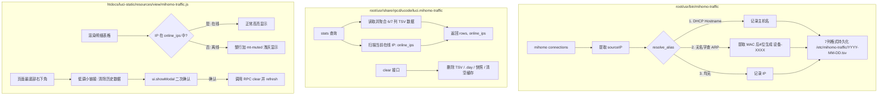

# 设备别名固化、离线状态浅灰与历史数据清除实现计划

## Summary

将 mihomo 流量统计改造为同时固化 IP 与设备别名（Hostname 优先，无名字时通过 ARP MAC 后 4 位兜底），保持以 IP 为物理隔离展示；后端 rpcd 补充在线活跃 IP 检测与数据清空方法；前端直接消费存储别名并对离线设备整行浅灰显示，同时在页面最底部右下角隐蔽新增带二次确认的历史数据清除功能。

---

## Problem Frame

原组件仅将客户端 IP 写入存储文件，依靠查看页面时动态读取 `/tmp/dhcp.leases` 反查主机名。当设备 DHCP 租约过期、离线或现代系统随机 MAC 轮换导致 IP 变动时，名称映射失效，历史记录退化为纯数字 IP。此外，用户缺少快速重置和清理测试流量的入口，且历史数据中无法区分哪些设备当前仍在网活跃。

本计划落实上游头脑风暴确立的双字段固化原则，补充在无主机名时使用 MAC 后 4 位兜底生成别名的机制，并在前端以低调方式补齐历史数据清空能力。

---

## Requirements

### 数据结构与持久化
- R1. 存储格式升级为 7 列（`hour \t ip \t alias \t node \t host \t upload \t download`），第 3 列为设备别名。
- R2. 设备别名生成策略严格按优先级执行：UCI 静态绑定或 DHCP 主机名优先；若缺失，回退读取 ARP 表提取 MAC 后 4 位生成 `设备-[XXXX]`；若均无则使用 IP 兜底。
- R3. 存储读取逻辑平滑兼容旧版 6 列 TSV 数据，老文件自动将别名补齐为 IP。

### 查询与在线状态感知
- R4. 后端 `stats` 接口在返回流量聚合行的同时，返回当前局域网处于有效租约或活跃 ARP 状态的 `online_ips` 集合。
- R5. 数据明细以物理 IP 独立成行，同一局域网下的重名设备各自独立，禁止跨 IP 强行合并。

### 前端渲染与交互
- R6. 前端展示直接读取记录自带的设备别名与 IP，彻底移除前端名称字典反查逻辑。
- R7. 前端明细表格针对当前已离线（不在 `online_ips` 中）的设备整行增加 `mt-muted` 浅灰样式。
- R8. 前端在报表页面最底部右下角放置低调淡灰小链接「清除历史数据」，点击弹出二次确认对话框，确认后调用后端清空数据并自动刷新视图。

### 权限与接口安全
- R9. `luci.mihomo-traffic` rpcd 服务新增 `clear` 调用，清空归档 TSV、日汇总与临时快照，并重置内存缓存。
- R10. rpcd ACL 配置文件增加对 `clear` 方法的调用授权。

---

## Key Technical Decisions

- **KTD1: TSV 字段扩展为 7 列并命名为别名列（alias）**：
  在 `ip` 与 `node` 之间新增 `alias` 字段。解析时通过字段长度判断新老格式（`length(f) == 7` 为新格式，`length(f) == 6` 为老格式），彻底避免数据迁移与重写负担。
- **KTD2: 采集端三级别名决策模型**：
  在采集进程中实现 `resolve_alias(ip)`：
  1. 静态绑定与动态 DHCP 主机名（有效且非 `*`）；
  2. `/proc/net/arp` 匹配到的有效 MAC 地址后 4 位，大写格式化为 `设备-A1B2`；
  3. 客户端 IP 自身。
  在采集常驻内存中维护 30 秒有效期的轻量缓存，避免每秒重复扫盘。
- **KTD3: 在线状态通过活跃租约与 ARP 实时检测**：
  在执行 `stats` 查询时，快速汇总 `/tmp/dhcp.leases` 中未到期的 IP 与 `/proc/net/arp` 中 flags 为 `0x2` 的 IP，合并为 `online_ips` 字典随 JSON 返回。
- **KTD4: 清除历史数据隐蔽放置与二次确认**：
  按用户要求，清除按钮放置在页面最底部（footer 区域右下角），采用 `mt-muted` 样式的小字纯文本链接。点击触发 `ui.showModal` 提示“确定清空所有流量历史数据吗？此操作不可撤销”，防止手抖误触。

---

## High-Level Technical Design



---

## Implementation Units

### U1. 别名解析与存储层 7 列兼容改造

**Goal:** 在基础库中实现别名生成、TSV 7 列格式读写与向后兼容逻辑。  
**Requirements:** R1, R2, R3  
**Dependencies:** 无  
**Files:**
- `root/usr/share/ucode/mihomo_traffic.uc`

**Approach:**
1. 实现 `get_arp_macs()`，读取 `/proc/net/arp`，过滤出有效 MAC 地址。
2. 实现 `resolve_alias(ip, names, arps)`：优先匹配 `names[ip]`（过滤 `*`）；缺失时匹配 `arps[ip]`，取末尾 4 位十六进制格式化为 `设备-[XXXX]`；最后回退为 `ip`。
3. 改造 `read_tsv(path, cb)`：当 `length(f) >= 6` 时回调，内部根据切分长度自动识别新旧格式：
   - 7 列格式：`[hour, ip, alias, node, host, up, down]`
   - 6 列老格式：`[hour, ip, ip, node, host, up, down]`（老格式 alias 默认为 ip）
4. 改造 `day_rows` 日汇总生成逻辑，同样按 `ip \t alias \t node \t host` 输出 6 列日汇总，保持小流量合并逻辑正常运行。
5. 更新 `FIELDS = ['src', 'node', 'host']` 相关的聚合键生成逻辑，`src` 维度在行对象中附带 `src_ip` 与 `src_alias`。

**Patterns to follow:** `root/usr/share/ucode/mihomo_traffic.uc` 中的 `read_tsv` 与 `day_rows` 编写模式。  
**Test scenarios:**
- Happy path: 读取包含 7 列的新格式 TSV，成功解析出独立的 `ip` 与 `alias`。
- Backward compatibility: 读取仅有 6 列的旧格式 TSV，系统平稳运行，`alias` 自动回退为 `ip`。
- Edge case: 设备无 DHCP 主机名但有 ARP MAC，成功生成 `设备-A1B2`。
- Edge case: 设备既无主机名也无 ARP（如外部 IP），成功回退为纯 IP。  
**Verification:** 使用 `ucode -c` 语法检查通过，并在独立脚本中运行解析验证无异常。

---

### U2. 采集进程写入升级

**Goal:** 采集常驻守护进程在每秒轮询归纳与每小时整点归档时，将别名作为独立列持久化。  
**Requirements:** R1, R2  
**Dependencies:** U1  
**Files:**
- `root/usr/bin/mihomo-traffic`

**Approach:**
1. 维护 `name_cache` 与 `last_cache_update`，每 30 秒刷新一次底层租约和 ARP 表，避免轮询高频读取文件。
2. 在构建 `agg` 键值时扩展为包含别名：
   `join('\t', [ m.type == 'Inner' ? INNER : ip, alias, c.chains?.[0] ?? '-', m.host || m.sniffHost || m.destinationIP || '-' ])`
3. 改造 `append_hour()`，写入 7 列 TSV 格式：
   `sprintf('%s\t%s\t%s\t%s\t%s\t%d\t%d\n', hour, ip, alias, node, host, up, down)`
4. 小流量目标（`< 16KB`）合并时，确保保留相同的 `ip` 和 `alias`。

**Patterns to follow:** `root/usr/bin/mihomo-traffic` 的 `run` 与 `append_hour`。  
**Test scenarios:**
- Happy path: 采集运行中，生成的快照和 TSV 每行均包含 7 列字段。
- Performance/Cache: 连续 1000 次连接处理不触发高频读取 `/proc/net/arp`。
- Inner connections: `m.type == 'Inner'` 连接正确标记为 `(内部)`。  
**Verification:** 进程启动后快照文件写入正确的 7 字段 JSON 键。

---

### U3. rpcd 接口扩展与权限更新

**Goal:** 在 ubus rpcd 服务中新增 `clear` 接口并返回在线 IP 集合。  
**Requirements:** R4, R9, R10  
**Dependencies:** U1  
**Files:**
- `root/usr/share/rpcd/ucode/luci.mihomo-traffic`
- `root/usr/share/rpcd/acl.d/luci-app-mihomo-traffic.json`

**Approach:**
1. 在 `stats` 调用返回体中新增 `online_ips` 字典：扫描当前系统租约未过期的 IP 及 `/proc/net/arp` 中活跃 IP，置为 `true`。
2. 新增 `clear` RPC 方法：
   - 严格安全遍历并删除 `DATA_DIR` 下匹配 `/\.(tsv|day)$/` 的归档文件。
   - 删除 `CUR_FILE`（`/tmp/mihomo-traffic.cur`）。
   - 通过 procd/ubus 重启 `mihomo-traffic` 采集服务（或发送信号），重置常驻后台进程内存中的 `agg`，杜绝旧内存数据二次刷盘。
   - 重置查询缓存：`cache = {}; cache_size = 0;`。
   - 返回 `{ success: true }`。
3. 在 `root/usr/share/rpcd/acl.d/luci-app-mihomo-traffic.json` 中配置安全授权，在 `write` 块中加入 `ubus["luci.mihomo-traffic"] = [ "clear" ]`，符合 OpenWrt 读写权限隔离规范。

**Patterns to follow:** `luci.mihomo-traffic` 中现有 `status` 和 `stats` 方法。  
**Test scenarios:**
- Happy path: 调用 `clear` 方法后，`DATA_DIR` 下的 `.tsv` 文件被全部清空，快照文件被删除，采集服务平稳重启重置内存。
- Query enrichment: 调用 `stats` 方法，响应 JSON 中包含 `online_ips` 且键值为当前有效 IP。
- Security: 非管理员写权限拒绝调用 `clear`。  
**Verification:** 语法检查通过，ACL JSON 格式合法。

---

### U4. 前端别名消费与离线整行浅灰置灰

**Goal:** 前端直接使用存储固化的别名，并根据在线状态将离线行整行显示为半透明浅灰。  
**Requirements:** R5, R6, R7  
**Dependencies:** U1, U3  
**Files:**
- `htdocs/luci-static/resources/view/mihomo-traffic.js`

**Approach:**
1. 废除前端 `renderCell` 中的 `stats.names` 字典拼接，直接取用数据中的 `alias` 和 `src`（IP），显示为：首行 `alias`，次行小字 `src`。
2. 在 `renderTable` 循环生成每条记录时，通过 `stats.online_ips?.[r.src]` 检查设备是否在线。
3. 若设备不在线且非 `(内部)` 行，为该行 `tr` 添加 `mt-muted` 类名：
   `class: 'tr' + (inner || !online ? ' mt-muted' : '')`
4. 保证整行文字、数字均以统一的 `opacity: .65` 呈现，直观突出在线活跃设备。

**Patterns to follow:** `renderTable` 中的 `mt-muted` 与 `renderCell` 模式。  
**Test scenarios:**
- Online device: 在线设备整行正常高亮显示。
- Offline device: 历史离线设备整行呈现浅灰色（`mt-muted`），数据内容完整保留。
- Multiple duplicate names: 两台同名设备分别呈现为两行，各自带有各自的 IP。  
**Verification:** 页面加载时能够按 `online_ips` 准确赋予类名。

---

### U5. 前端页脚隐蔽清除按钮与二次确认交互

**Goal:** 在页面底部右下角添加低调的清除数据小字链接，附带确认弹窗。  
**Requirements:** R8  
**Dependencies:** U3, U4  
**Files:**
- `htdocs/luci-static/resources/view/mihomo-traffic.js`

**Approach:**
1. 声明 `callClear = rpc.declare({ object: 'luci.mihomo-traffic', method: 'clear' })`。
2. 在 `renderHistory` 的表格最下方，追加一个右对齐的页脚小容器：
   ```javascript
   E('div', { style: 'text-align:right;margin-top:1.5em;padding-bottom:1em' }, [
       E('a', {
           href: '#',
           class: 'mt-muted',
           style: 'font-size:85%;text-decoration:none;cursor:pointer',
           click: ui.createHandlerFn(this, 'handleClear')
       }, '清除历史数据')
   ])
   ```
3. 实现 `handleClear()` 方法：
   调用 `ui.showModal('清除历史数据', [ E('p', {}, '确定要清空所有已保存的流量历史数据吗？此操作不可撤销。'), ... ])`，包含“取消”和“确定清空”按钮。
4. 点击“确定清空”后调用 `callClear()`，成功后关闭弹窗，通过 `ui.addNotification(null, E('p', {}, '历史流量数据已清除'), 'info')` 给出轻量成功提示，并调用 `this.refresh()` 刷新视图。

**Patterns to follow:** LuCI 官方的 `ui.showModal` 与 `rpc.declare` 模式。  
**Test scenarios:**
- Visual layout: 按钮位于整张页面最底部右下角，字体小且为浅灰，不干扰正常视觉。
- Modal confirmation: 点击链接弹出二次确认弹窗，点击“取消”不执行任何操作。
- Clear action: 点击“确定清空”后触发 RPC，历史数据清空，页面刷新为“暂无数据”。  
**Verification:** 代码检查事件挂载和回调逻辑完整。

---

### U6. 冒烟测试与回归验证套件更新

**Goal:** 更新 `tests/smoke.sh`，覆盖 7 列格式、6 列兼容性与数据清空测试。  
**Requirements:** R1, R3, R9  
**Dependencies:** U1, U2, U3  
**Files:**
- `tests/smoke.sh`

**Approach:**
1. 在 `smoke.sh` 中构造包含 7 列的新测试数据和 6 列的老测试数据。
2. 验证混合读取时聚合指标完全一致。
3. 验证无主机名时的 MAC 后 4 位兜底逻辑。
4. 验证 `clear` 清除功能后数据目录为空。

**Patterns to follow:** `tests/smoke.sh` 现有的测试断言机制。  
**Test scenarios:**
- 7-col parsing: 正确解析包含 alias 的行。
- 6-col backward compat: 老格式无报错且正确统计。
- Clear operation: 清理后返回状态一致。  
**Verification:** 执行 `tests/smoke.sh` 全部输出 `ok` 和 `all passed`。

---

## Acceptance Examples

- AE1. 租约到期后历史记录完整保留别名并浅灰显示
  - **Covers:** R1, R2, R6, R7
  - **Given:** 设备 `192.168.1.100`，主机名 `My-Phone`，产生了 10 GB 流量，现已断开且租约过期。
  - **When:** 打开 LuCI 流量统计页面。
  - **Then:** 设备列展示为首行 `My-Phone`、次行小字 `192.168.1.100`，整行以半透明浅灰显示，历史数据完整可见。

- AE2. 无主机名 IoT 设备通过 MAC 后 4 位识别
  - **Covers:** R2, R6
  - **Given:** 设备 `192.168.1.188`，DHCP 名字为 `*`，系统 ARP 记录其 MAC 为 `CC:DD:EE:FF:56:78`。
  - **When:** 采集进程写入数据并呈现在前端。
  - **Then:** 设备名称自动显示为 `设备-5678 (192.168.1.188)`。

- AE3. 页脚清除历史数据并防误触
  - **Covers:** R8, R9, R10
  - **Given:** 用户希望重置当前的测试流量统计。
  - **When:** 滑动到页面最底部右下角，点击浅灰文字「清除历史数据」，在弹出的对话框中点击「确定清空」。
  - **Then:** 后端数据文件被清空，页面自动刷新并提示“暂无数据”。

---

## Scope Boundaries

### In Scope
- 数据格式升级为 7 列并支持别名。
- 无主机名时的 ARP MAC 后 4 位兜底提取。
- rpcd 接口支持返回在线 IP 集合并提供 `clear` 功能。
- 前端设备名直读、离线整行浅灰、页脚右下角清除链接与弹窗。
- 升级前后数据兼容与 `tests/smoke.sh` 覆盖。

### Deferred to Follow-Up Work
- 针对单个特定设备的局部历史记录删除（目前只提供全局清空）。
- 自定义设备在线判定超时时间阈值。
